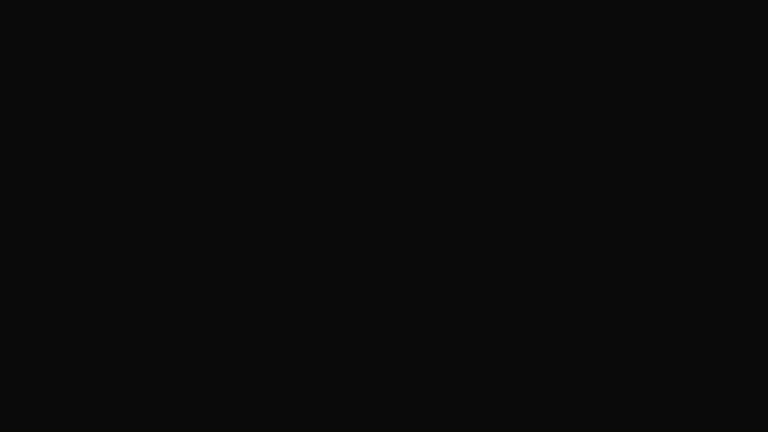
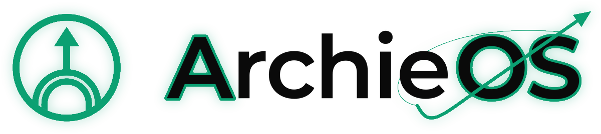
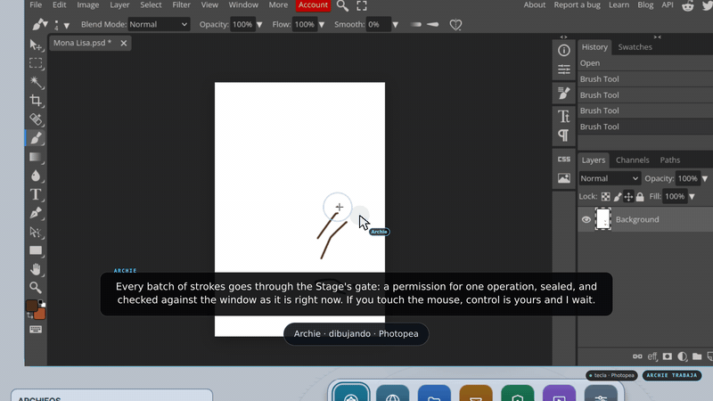
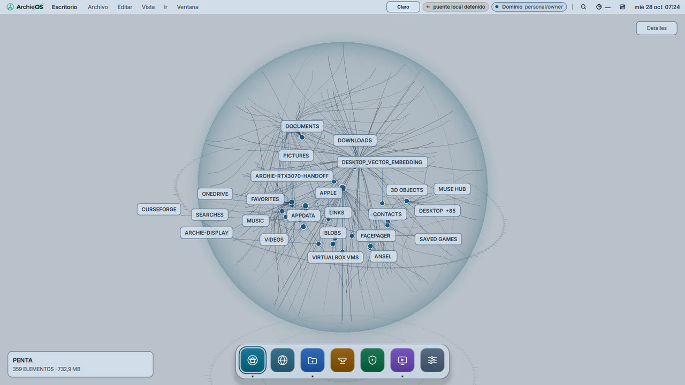
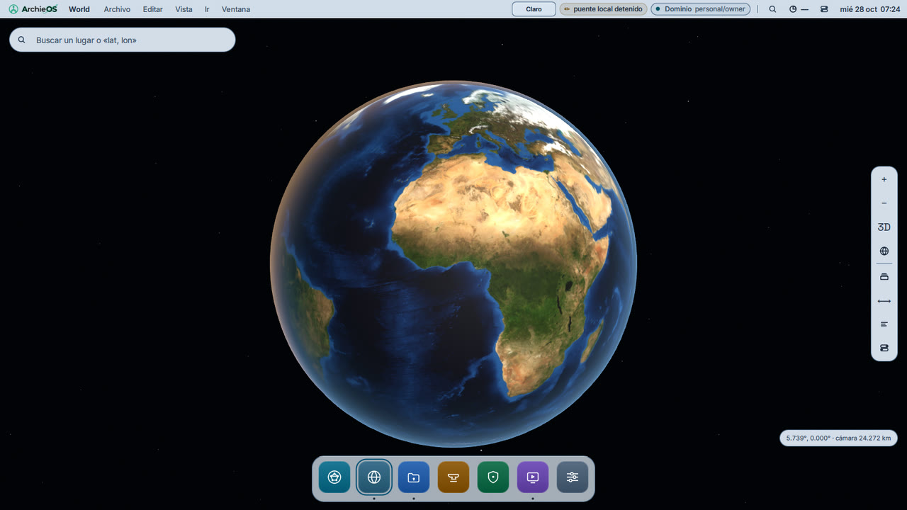
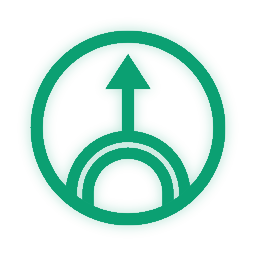

<div align="center">

[English](README.md) · [Español](README.es.md) · [Português](README.pt-BR.md) · [Français](README.fr.md) · **中文**

<br>



<br>
<br>

<picture>
  <source media="(prefers-color-scheme: dark)" srcset="display/shell/brand/archieos-logo-dark.png">
  
</picture>

### 住在操作系统里的个人 AI —— 动手之前，先征得你的同意。

[](LICENSE)


</div>

---

## ArchieOS 是什么？

ArchieOS 是一个内置助手 **Archie** 的操作系统。你可以用自己的话和它交谈（英语或西班牙语）。
它会开口回答，打开你的应用，并像人一样使用它们：移动自己的指针、点击、输入、画画。

它的不同之处在于**由谁做主**。AI 模型从不直接操作你的电脑，它只能*提议*一个动作。
由操作系统决定这个动作是否被允许，只放行一次，在最后一刻再检查一遍，并留下一张回执。
你一动鼠标，控制权就立刻回到你手里。

<div align="center">

</div>

## 看看效果

**“Archie, draw the Mona Lisa.”** Archie 在浏览器里打开 Photopea，拿起画笔，用自己的指针一笔一笔地
画出这幅画 —— 先用棕褐色，再用红粉笔，就像达·芬奇当年那样 —— 一边画一边讲解自己在做什么。

<div align="center">

</div>

**桌面。** 一个窗口包揽一切：显示机器正在做什么的光球、程序坞（Vault、Forge、Sentry、World、
Stage、设置），以及 Archie 在上面打开的内容。它会跟随你的浅色或深色主题。

<div align="center">
<picture>
  <source media="(prefers-color-scheme: dark)" srcset="docs/readme/desktop-dark.jpg">
  
</picture>
</div>

**World。** 被真实太阳照亮的地球，头顶是真实的夜空；简洁的搜索框（地名或“纬度, 经度”）、图层、
标尺，以及 Archie 的控制台。

<div align="center">
<picture>
  <source media="(prefers-color-scheme: dark)" srcset="docs/readme/world-dark.jpg">
  
</picture>
</div>

## 它如何让你始终掌控

<div align="center">

</div>

1. **模型提议。** Nemotron（运行在 Nebius 上）或本地模型把你说的话变成一个建议动作，
   例如 `draw_picture("Mona Lisa")` 或 `open_app("Sentry")`。
2. **Cerebra 决定。** ArchieOS 自己的推理层检查这个请求是否合理 —— 必要时先问你。
3. **策略授权。** 一个普通的文本文件（`apps.toml`）列出 Archie 可以打开哪些应用、在每个应用里
   可以做什么。被允许的动作会得到一份只能用一次的密封租约；其余一律拒绝。
4. **Stage 执行。** Stage 是 Archie 工作所在的窗口系统。它再核对一次租约和目标窗口，
   只做那一件事，然后返回回执。
5. **永远是你说了算。** 一碰鼠标或键盘，屏幕就会显示 **HUMAN CONTROL（人工控制）**；
   Archie 立即停下等待。安静几秒后，它才可能继续。

## 现在就能做什么

| | |
| --- | --- |
| 🎙️ **对话** | 在你的机器上语音进、语音出。NVIDIA Nemotron 3.5 流式语音识别，Nebius 上的 Nemotron 负责回答，再加上本地语音（CPU 用 Piper，GPU 用 Magpie）。你用什么语言，Archie 就用什么语言回答。 |
| 🖱️ **操作** | 打开应用、点击、输入、滚动、拖拽和绘画 —— 全部经过 Stage 和它的策略。Archie 优先通过无障碍接口找到按钮，只有必要时才去“看”屏幕。 |
| 🎨 **绘画** | 在 Photopea 中“画蒙娜丽莎”（以及它会画的其他作品），节奏和人一样，录成视频也看得清。 |
| 🌍 **探索** | World：地球、真实的阳光、真实的星空，可按地名或坐标定位。 |
| 🛡️ **守护** | Sentry：你的网络里有什么、谁在和谁通信。 |
| 👁️ **视觉** | IRIS，Archie 的眼睛：告诉它找什么，它告诉你在哪里。人脸一律遮挡 —— 它从不识别人。 |
| 🎬 **剪辑视频** | 用 MLT（Kdenlive 的引擎）在无窗口环境下渲染片段、标题、音乐和淡入淡出组成的时间线。 |
| 🧩 **连接** | 通过 MCP 把 Archie 的工具提供给编程智能体。 |

## 试一试

ArchieOS 以 Linux 系统的形式运行：在 PC 上、虚拟机里，或 **Windows 上的 WSL2** 中。

**在 Windows（WSL2）上。** 构建镜像并安装：

```bash
sudo ./scripts/wsl/build-rootfs.sh ./dist
```

```powershell
wsl --install --from-file .\dist\ArchieOS.wsl
```

然后按照[首次运行](docs/FIRST-RUN.md)操作。[WSL 构建指南](docs/WSL-BUILD.md)和
[安全边界](docs/SECURITY-BOUNDARY.md)说明了镜像包含什么、隔离了什么。

**蒙娜丽莎演示。** 在 ArchieOS 里（或任何已编译好相关组件的 Linux 上），一条命令即可打开桌面、
浏览器，并让 Archie 用英语和西班牙语聆听：

```bash
display/session/nebius-demo.sh
```

需要先编译什么、可用选项以及建议的演示脚本，见 [`docs/DEMO-NEBIUS.md`](docs/DEMO-NEBIUS.md)。

<details>
<summary><b>从源码构建</b></summary>

<br>

控制平面使用 Rust（1.88+）；桌面和 Stage 使用 C++ 与 Qt 6。

```bash
# Archie 的语音、双手和工具
cd core
cargo build --release -p archie-voice --features speech
cargo test --workspace --locked

# Stage（Wayland 合成器）和桌面
cmake -S display/stage  -B build/stage   -G Ninja && cmake --build build/stage
cmake -S display/native -B build/display -G Ninja && cmake --build build/display
```

`--features speech` 需要 NeMo-Speech.cpp（`NEMO_SPEECH_PREFIX`）和 PulseAudio；
`scripts/models/install-nemotron-speech.sh` 会下载固定版本的识别模型，
`scripts/models/install-piper-runtime.sh` / `install-piper-voices.sh` 会安装本地语音。

使用 Nebius Token Factory 密钥，与 Archie 和 Stage 对话：

```bash
NEBIUS_TOKEN_FACTORY_KEY=... display/stage/run-archie.sh public
```

负责回答的模型可以替换：NVIDIA NIM、Nebius Token Factory，或任何兼容 OpenAI 的本地服务器。
密钥只在每次请求时读取，绝不会写入仓库或镜像。`scripts/check.sh` 会运行推送前值得跑的检查。

</details>

## 内部结构

```text
 麦克风 ─► Nemotron 3.5 ASR ─► 话轮 ─► Nemotron (Nebius) ─► 语音 (Piper / Magpie)
                                        │ 提议
 摄像头 ─► IRIS ─► 场景 + 记忆 ─────────┤
                                        ▼
                          Cerebra ─► 策略 ─► Stage ─► 应用
                                        │
                   TFOG 信号 ─► archie-displayd ─► 桌面 (光球 · Forge · World)
```

- **Rust** 负责权限、策略、调度器、模型路由、记忆与状态（PostgreSQL/TimescaleDB）、Cerebra 和 Vault。
- **C++ / Qt Quick 3D** 负责桌面、光球、World、Cortex、Sentry 和 Stage。
- 身份、记忆、策略和权限都存在于 ArchieOS 中；语言和视觉模型是它可替换调用的资源。

## 项目状态

这是为 NVIDIA × Nebius 黑客松打造的 alpha 版本。坦白地说：

- **可用且已测试：** 英语和西班牙语的端到端语音对话、Stage 及其策略、用语音打开和操作应用、
  蒙娜丽莎绘画、World、浅色与深色桌面、IRIS 检测、视频渲染、WSL2 镜像。
- **进行中：** IRIS Beta 2 训练；Cortex 按指令控制桌面视角；IRIS 提议点击以外的动作；
  无需 Python 的 IRIS 运行时的 CUDA 构建。
- **已知限制：** 绘画按人的节奏进行（以分钟计，而非秒）；在 ArchISO 镜像中，应用通过 Stage 打开，
  而不是从 Forge 打开；GitHub Actions 暂停期间，CI 在本地运行。

## 延伸阅读

[架构](ARCHITECTURE.md) · [Archie](ARCHIE.md) · [黑客松来源说明](HACKATHON.md) ·
[Stage](docs/STAGE.md) · [语音](docs/SPEECH-NEMOTRON.md) · [IRIS](docs/IRIS.md) ·
[IRIS 运行时](docs/IRIS-RUNTIME.md) · [安全](docs/SECURITY.md) ·
[World](docs/WORLD-EXPLORATION.md) · [光球渲染](docs/TFOG-ORB-RENDERING.md)

## 致谢

- **PentaVM** —— 架构、Rust 与 C++ 实现、控制平面、IRIS、语音栈和原生桌面。
- **Xavi**（[`ByXavi270`](https://github.com/ByXavi270) / XaviCottier）—— 设计：桌面、神经球体、
  标志及其开机动画。
- **Santiago Rearte**（Sheriff）—— Nebius Token Factory 与 Nemotron 的集成，并在他自己的 WSL 上测试。
- 基于 NVIDIA Nemotron、NeMo 和 NIM、Nebius Token Factory、Piper、MLT、Qt 和 Wayland 构建。

## 许可证

Apache License 2.0 —— 见 [LICENSE](LICENSE) 和 [NOTICE](NOTICE)。选择 Apache 而非 MIT，是因为它包含
专利授权：本仓库涉及设备控制、物理执行和推理路由。数据提供方保留各自的条款；`providers/`
记录了每家要求的署名，缺少署名的数据 ArchieOS 一律拒绝显示。

<div align="center">

<br>

<picture>
  <source media="(prefers-color-scheme: dark)" srcset="display/shell/brand/archieos-icon-256.png">
  
</picture>

**Made with love ♥**

*PentaVM、Xavi 与 Sheriff 用心打造*

</div>
